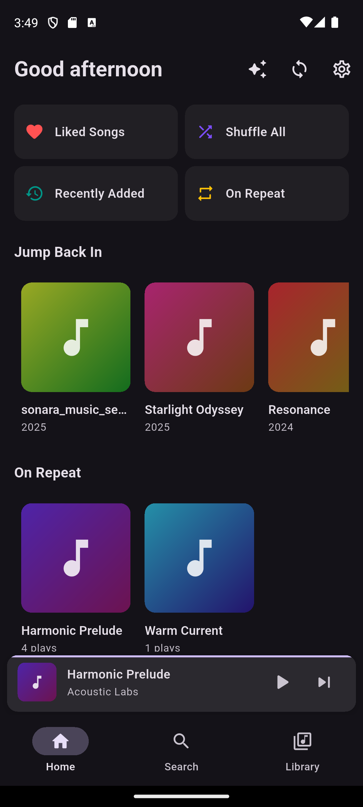
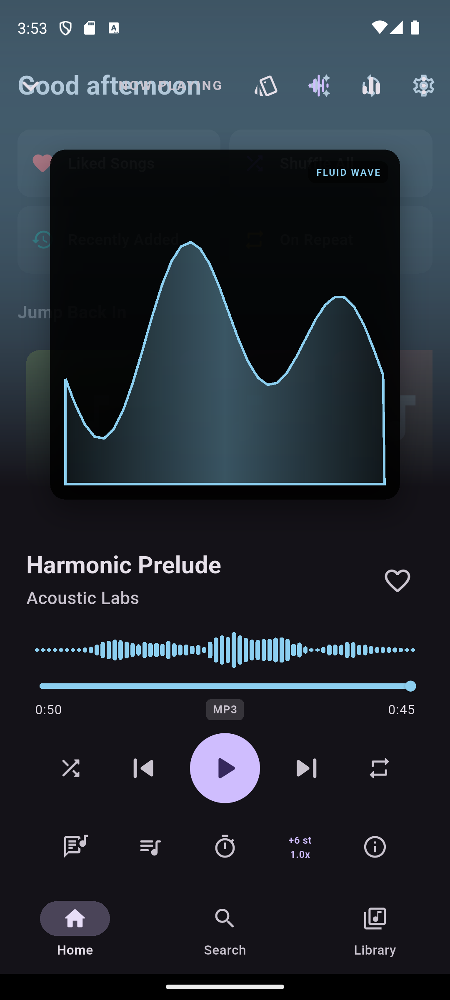
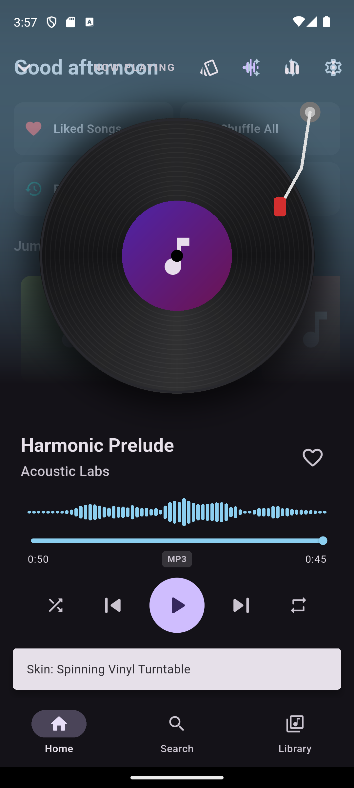
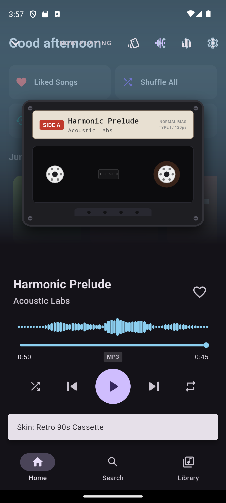
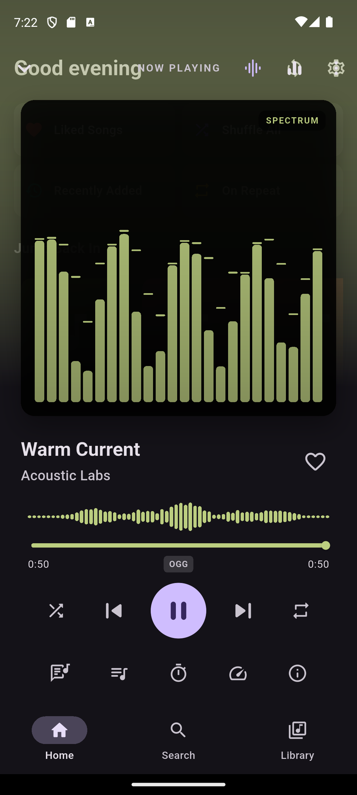
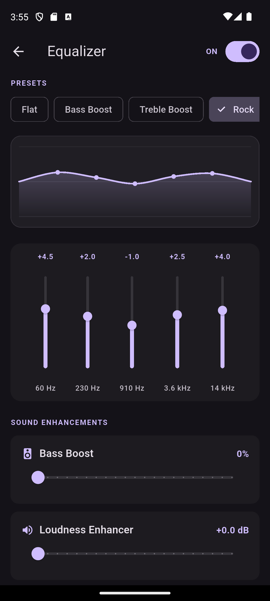
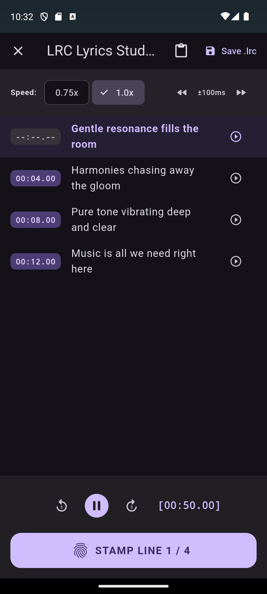
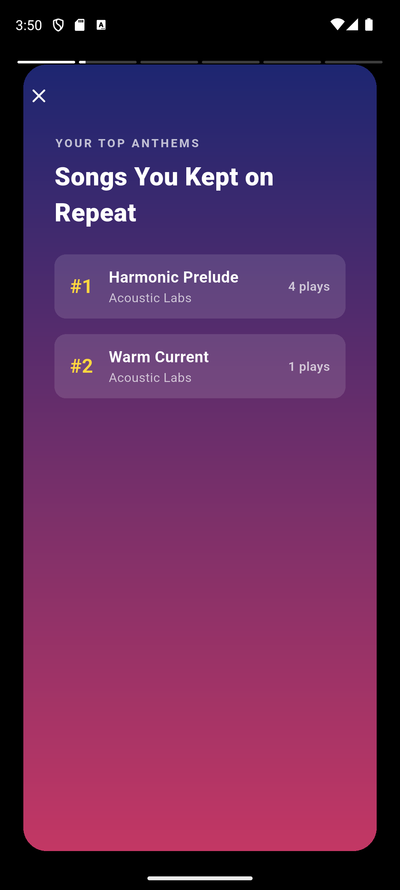

# 🎵 Sonara

<p align="center">
  <strong>A modern, audiophile-grade, 100% offline & private music player for Android.</strong><br>
  Crafted with Flutter & Dart • No Ads • No Tracking • Zero Internet Permissions
</p>

<p align="center">
  <a href="https://flutter.dev"></a>
  <a href="https://dart.dev"></a>
  <a href="https://developer.android.com"></a>
  <a href="LICENSE"></a>
  
  <a href="../../releases/latest"></a>
</p>

<p align="center">
  <a href="#-quick-download"><strong>📥 Download APK</strong></a> •
  <a href="#-screenshots"><strong>📸 Screenshots</strong></a> •
  <a href="#-key-features"><strong>✨ Key Features</strong></a> •
  <a href="#-prerequisites--installation"><strong>🚀 Getting Started</strong></a> •
  <a href="#-building-from-source"><strong>🛠️ Build Source</strong></a> •
  <a href="#-architecture"><strong>🏗️ Architecture</strong></a>
</p>

---

## 🌟 Overview

**Sonara** is an offline music player designed from the ground up for music enthusiasts who value their privacy, battery life, and audio quality. 

Unlike modern streaming clients that harvest telemetry, display ads, or require constant connectivity, Sonara enforces a strict **zero-network invariant**: `android.permission.INTERNET` is completely omitted from the release manifest. Your library, listening statistics, and playlists never leave your device.

Sonara pairs a responsive, Material 3 tactile interface with an industrial audio engine capable of fluidly navigating **20,000+ tracks**, playing gapless audio, computing ReplayGain normalization, transposing musical pitch in real-time, and rendering synchronized lyrics.

---

## 📥 Quick Download

Get the latest production build ready for immediate sideloading on any Android device running Android 8.0+:

| Release | Architecture | File | Direct Link |
| :--- | :--- | :--- | :--- |
| **v1.0.0 (Latest)** | **Universal (All Phones)** | `app-release.apk` | [**Download APK (v1.0.0)**](../../releases/latest) |
| v1.0.0 | ARM64 (Modern Devices) | `app-arm64-v8a-release.apk` | [Download ARM64](../../releases/latest) |
| v1.0.0 | ARMv7 (Older Devices) | `app-armeabi-v7a-release.apk` | [Download ARMv7](../../releases/latest) |

---

## 📸 Screenshots

<table align="center">
  <tr>
    <td align="center" width="25%">
      <strong>Dynamic Home</strong><br>
      
    </td>
    <td align="center" width="25%">
      <strong>Now Playing (Modern)</strong><br>
      
    </td>
    <td align="center" width="25%">
      <strong>Turntable Skin</strong><br>
      
    </td>
    <td align="center" width="25%">
      <strong>90s Cassette Deck</strong><br>
      
    </td>
  </tr>
  <tr>
    <td align="center" width="25%">
      <strong>60 FPS Visualizer</strong><br>
      
    </td>
    <td align="center" width="25%">
      <strong>5-Band Hardware EQ</strong><br>
      
    </td>
    <td align="center" width="25%">
      <strong>Synchronized Lyrics Studio</strong><br>
      
    </td>
    <td align="center" width="25%">
      <strong>100% Offline Wrapped</strong><br>
      
    </td>
  </tr>
</table>

---

## ✨ Key Features

### 🎧 Audiophile Playback Engine
- **Hardware Equalizer & Presets:** 5-band parametric equalizer with Catmull-Rom Bezier curve visualization, 9 handcrafted presets (*Flat, Bass Boost, Treble Boost, Rock, Pop, Jazz, Electronic, Vocal, Classical*), and user custom profiles.
- **Hardware Bass Boost & Loudness Enhancer:** Deep bass amplification and loudness enhancement up to +10 dB.
- **ReplayGain & Peak Limiter:** Smart volume normalization across tracks and albums with configurable pre-amp (-12 dB to +12 dB) and anti-clipping limiter.
- **Gapless Playback & Crossfade:** Configurable crossfade transitions (0s to 12s) with cubic volume ramping eliminating DAC clicks and abrupt stops.
- **Pitch Transposition & Speed Control:** Musical pitch shifting across $\pm 12$ semitones ($2^{S/12}$) independent of tempo, plus pitch-preserved speed adjustments (0.5x to 2.0x).
- **Per-Device Audio Profiles:** Detects output route changes (*Phone Speaker, Bluetooth, Wired IEMs, USB DAC*) and automatically applies corresponding EQ, loudness, and crossfade settings.
- **Real-Time 60 FPS Visualizer:** 16-band Spectrum bars with peak decay, analog dual VU meters, and fluid Bezier wave visualizers alongside interactive amplitude peak waveform scrubbers.

### 📚 Library & Smart Management
- **Instant FTS5 Search:** Full-text SQLite search responding in <50ms across tracks, artists, albums, and playlists with search chips and hero cards.
- **Scalable 20,000+ Track Queue:** Sliding-window queue manager loads only upcoming tracks into the playback engine, preventing memory bloat on massive collections.
- **In-App Tag & Artwork Editor:** Edit ID3v2.3 (MP3) and Vorbis comments (FLAC) directly on disk. Supports Scoped Storage write permission requests on Android 11+.
- **Lossless Audio Cutter & Ringtone Maker:** Extract segments using native `MediaExtractor` / `MediaMuxer` with waveform trimming, A-B loop preview, and one-tap assignment as ringtones or alarms.
- **CUE Sheet Parser:** 75fps frame-accurate parsing of `.cue` sidecars for single-file album rips with seamless virtual track playback.
- **Duplicate Audio Finder:** Scans audio collections and groups duplicate recordings by title, artist, and duration ($\pm 2\text{s}$) with bulk cleanup.
- **M3U / M3U8 Playlist Engine:** Full UTF-8 playlist import/export with intelligent 3-tier fallback track matching.
- **Smart Playlists:** Dynamic rule engine with boolean and date filters (*Recently Added, Most Played, Top Rated, Forgotten Favorites*).

### 🎨 Tactile & Dynamic Interface
- **Material 3 Dynamic Palette:** Off-thread palette extraction via `material_color_utilities` (`QuantizerCelebi`), generating dynamic ambient gradients from album art.
- **Interactive Player Skins:** Switch seamlessly between:
  - **Modern Dynamic:** Adaptive art glow and fluid animations.
  - **Spinning Vinyl:** Realistic turntable with animated tonearm physics.
  - **Retro 90s Cassette:** Nostalgic cassette deck with dual spinning reels and magnetic tape simulation.
  - **Minimalist OLED:** Pure true-black theme optimized for battery saving on AMOLED displays.
- **Synchronized Lyrics Studio:** Live auto-scrolling lyrics with tap-to-seek, paired with a dedicated studio to stamp, adjust ($\pm 100\text{ms}$), and export RFC-compliant `.lrc` files.
- **Offline "Wrapped" Year-End Stories:** Spotify-style listening recaps generated entirely on-device from SQLite statistics, exportable as high-res shareable image cards without network communication.
- **Acoustic "Track Radio":** Intelligent on-device clustering queue that analyzes genre affinity, era proximity, and artist discography.

### 📱 Android Ecosystem Integration
- **Android Auto Dashboard:** Native `MediaBrowserServiceCompat` integration for steering-wheel and in-car infotainment navigation.
- **Home Screen Widgets:** Multiple widget form factors (2×1 Minimalist Pill, 4×1 Standard Player, 4×2 Expanded Card with album art).
- **Dynamic Launcher Shortcuts:** Long-press launcher icon to jump to *Shuffle All*, *Liked Songs*, *Recently Played*, or *Search*.
- **Smart Sleep Gestures:** Accelerometer detection enables shake-to-extend (+15m) during volume fadeouts and flip-face-down-to-pause.
- **Zero Network Invariant:** Enforced via custom Gradle verification (`verifyNoInternetPermission`) guaranteeing that release builds strictly omit `android.permission.INTERNET`.

---

## 🚀 Prerequisites & Installation

### Device Requirements
- **OS:** Android 8.0 (Oreo / API level 26) or newer.
- **Storage:** ~50 MB of free storage.
- **Permissions:** Media audio permission (`READ_MEDIA_AUDIO` on Android 13+ or `READ_EXTERNAL_STORAGE` on Android 12 and below).

### Manual Installation (Sideloading)
1. Download **`app-release.apk`** from [Releases](../../releases/latest).
2. On your Android device, tap the downloaded `.apk` file.
3. If prompted, enable **"Install unknown apps"** in your Android Settings for your browser or file manager.
4. Tap **Install** and launch Sonara!

---

## 🛠️ Building From Source

### Development Prerequisites
- **Flutter SDK:** `>= 3.13.5` (Channel `stable`)
- **Dart SDK:** `>= 3.1.0`
- **Java Development Kit (JDK):** Version 17
- **Android SDK:** Platform SDK 34, Build Tools 34.0.0+
- **Git**

### Build Steps

1. **Clone the repository:**
   ```bash
   git clone https://github.com/hunterkasa/sonara.git
   cd sonara
   ```

2. **Install Flutter dependencies:**
   ```bash
   flutter pub get
   ```

3. **Verify static analysis and formatting:**
   ```bash
   flutter analyze
   dart format --output=none --set-exit-if-changed .
   ```

4. **Execute automated test suites:**
   ```bash
   flutter test
   ```
   *(300+ unit, widget, and integration tests execute with 100% pass rate).*

5. **Run on a connected Android device or emulator:**
   ```bash
   flutter run
   ```

6. **Compile production Release APKs:**
   ```bash
   # Universal release APK (works on all Android devices)
   flutter build apk --release

   # OR build architecture-optimized split APKs (~20MB each)
   flutter build apk --release --split-per-abi
   ```
   Binaries are generated in: `build/app/outputs/flutter-apk/`.

---

## 🏗️ Architecture

Sonara is engineered with a strict 3-tier reactive pattern:

```
lib/
├── app/          # App bootstrap, go_router navigation, theme tokens, l10n (EN, AR, BN, ZH)
├── core/         # Error handling, offline logger, native bridges, utility parsers (LRC, CUE)
├── data/         # Drift SQLite DB (WAL & FTS5), MediaStore scanners, pure-Dart tag readers
├── domain/       # Logical queue manager, smart playlist engine, radio similarity clustering
├── audio/        # SonaraAudioHandler, audio_service foreground session, PlaybackController
├── features/     # Home, Search, Library, Now Playing, Equalizer, Cutter, Wrapped, Settings
└── shared/       # Artwork cache, track tiles, waveform scrubbers, 60fps visualizers
```

### Architectural Principles
- **Drift SQLite as Single Source of Truth:** The UI consumes reactive streams from Drift SQLite tables; duplicate in-memory state is forbidden.
- **Audio Stack Isolation:** The UI never communicates with audio plugins directly. All playback operations route through the `PlaybackController` domain abstraction.
- **Background Isolate Processing:** Heavy file scanning, deep tag extraction, and palette downsampling execute in dedicated Dart worker isolates.
- **Deterministic Identity:** Songs are uniquely identified by a SHA-256 `trackKey` computed from normalized metadata, preserving playlists across file moves and renames.

---

## 🤝 Contributing

Contributions, feature suggestions, and bug reports are welcome!

1. Fork the Project
2. Create your Feature Branch (`git checkout -b feature/AmazingFeature`)
3. Ensure all tests pass (`flutter test && flutter analyze`)
4. Commit your Changes (`git commit -m 'feat: add amazing feature'`)
5. Push to the Branch (`git push origin feature/AmazingFeature`)
6. Open a Pull Request

---

## 📄 License

Distributed under the **MIT License**. See [`LICENSE`](LICENSE) for complete details.

---

<p align="center">
  Built with ❤️ for music lovers everywhere • 100% Free, Private & Open Source
</p>
